# Lab 01: A Small Network, Imperfectly Built

> TLDR: I built a small two-machine network on RHEL 10.2 VMs, where one server acts as the entire network for a client: it hands out IP addresses over DHCP with dnsmasq, answers DNS queries, and routes and NATs the client’s traffic to the internet using firewalld zones and policies.

---

## What I built

Two RHEL 10.2 virtual machines on my Windows laptop, wired together so that one acts as the other's entire network. When `client` boots with no network configuration:

- it gets an IP address over **DHCP** from `server`
- it resolves names using `server` as its **DNS** server
- it reaches the internet only through `server`, which **routes and NATs** its traffic

This is a small version of what a home router or an office network does.

```
   Internet
      │
 VirtualBox NAT (10.0.2.2)
      │
 ┌────┴──────────────────────────┐
 │ server                        │
 │  enp0s3  10.0.2.15  external  │  ← NAT / masquerade
 │  enp0s8  10.0.0.1   internal  │  ← dnsmasq: DHCP + DNS
 └────┬──────────────────────────┘
      │  labnet (VirtualBox internal network, 10.0.0.0/24)
 ┌────┴──────────────────────────┐
 │ client                        │
 │  enp0s3  10.0.0.139 (DHCP)    │
 │  default via 10.0.0.1         │
 └───────────────────────────────┘
```

**Stack:** RHEL 10.2 · VirtualBox · NetworkManager (`nmcli`) · firewalld · dnsmasq · tcpdump

---

## The build

### 1. The VMs
Two VMs with 2 GB RAM, 2 CPUs, and 20 GB disk each, installed with the "Server" profile (no GUI, since RHCSA is all command line). I built `server` first, then cloned it to make `client`.

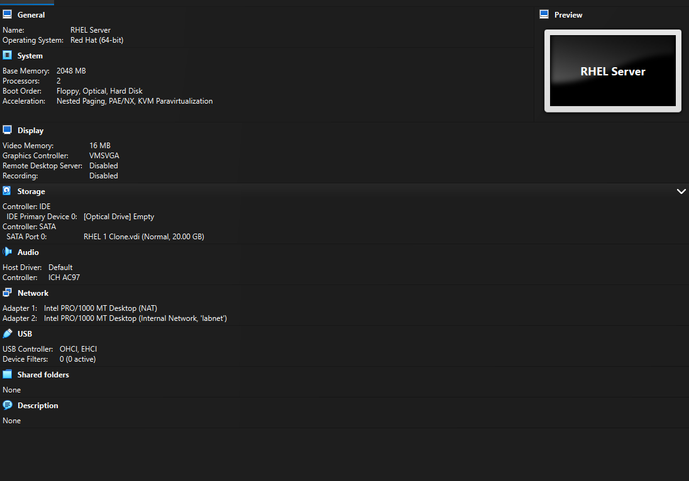

After cloning, the clone still had the original's identity, so I gave `client` a new hostname, regenerated its machine ID, and re-registered it with Red Hat. Without a new machine ID, both VMs could look like the same DHCP client and fight over one IP.

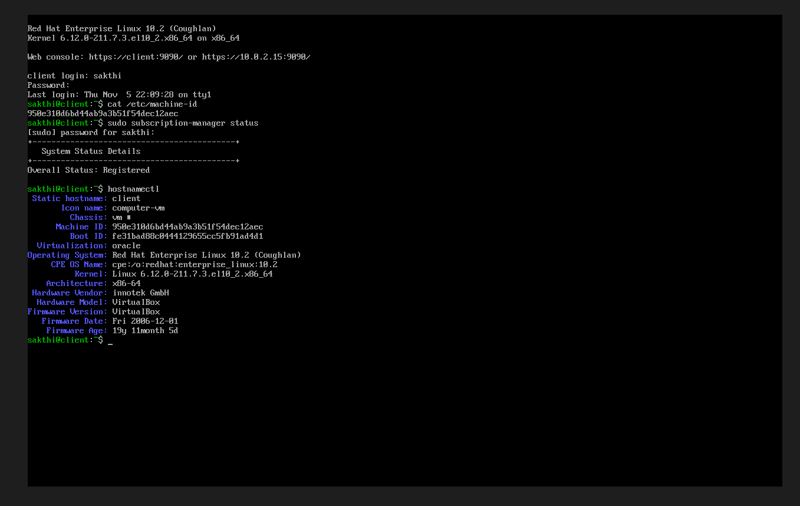

### 2. Server: lab-side IP and firewall zones
```bash
sudo nmcli con add type ethernet ifname enp0s8 con-name lab \
  ipv4.method manual ipv4.addresses 10.0.0.1/24 \
  ipv6.method disabled connection.zone internal
sudo nmcli con up lab
sudo nmcli con mod enp0s3 connection.zone external
sudo nmcli con up enp0s3
```
I assigned the zones through NetworkManager rather than firewalld directly, so they survive reboots.

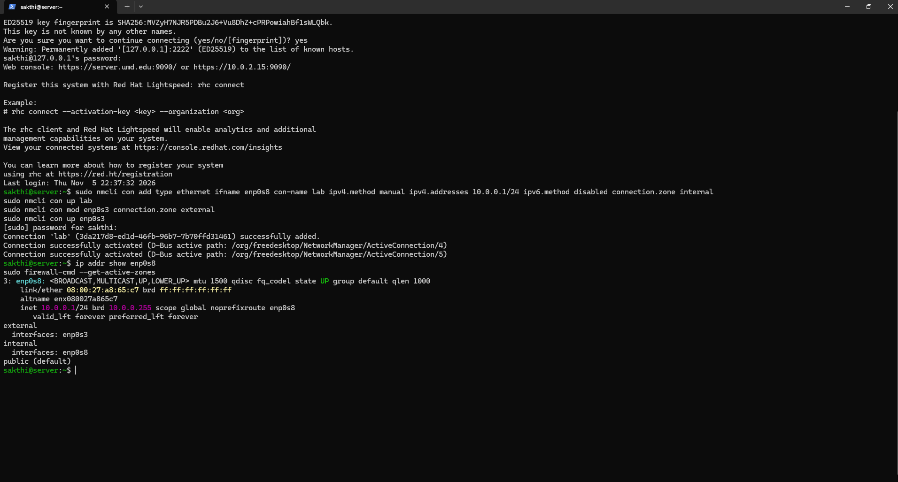

### 3. IP forwarding
```bash
echo 'net.ipv4.ip_forward=1' | sudo tee /etc/sysctl.d/90-forward.conf
sudo sysctl --system
```
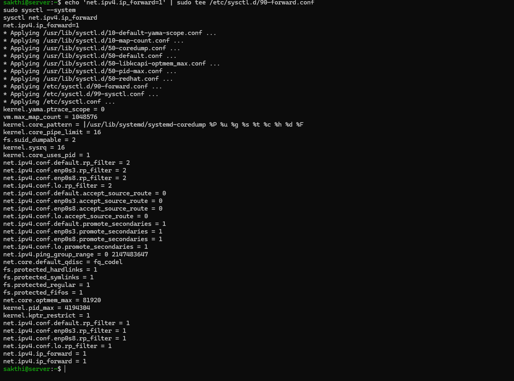

That output also set `rp_filter = 1` (strict reverse-path filtering). It doesn't affect this setup, but it's a known cause of one-way traffic problems, so I'm noting it to dig into later.

### 4. Firewall: allow services and forwarding
```bash
sudo firewall-cmd --permanent --zone=internal --add-service=dhcp --add-service=dns
sudo firewall-cmd --permanent --new-policy int2ext
sudo firewall-cmd --permanent --policy int2ext --add-ingress-zone internal
sudo firewall-cmd --permanent --policy int2ext --add-egress-zone external
sudo firewall-cmd --permanent --policy int2ext --set-target ACCEPT
sudo firewall-cmd --reload
```
The `int2ext` policy is what lets lab traffic out. The NAT itself comes from the `external` zone, which has masquerade on by default, so the policy's own `masquerade: no` is expected.

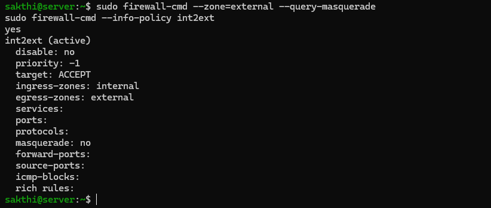

### 5. dnsmasq for DHCP and DNS
`/etc/dnsmasq.d/lab.conf`:
```ini
interface=enp0s8
bind-interfaces
domain=lab.internal
dhcp-range=10.0.0.100,10.0.0.200,12h
dhcp-option=option:router,10.0.0.1
dhcp-option=option:dns-server,10.0.0.1
address=/server.lab.internal/10.0.0.1
server=1.1.1.1
```
```bash
sudo dnsmasq --test
sudo systemctl enable --now dnsmasq
```
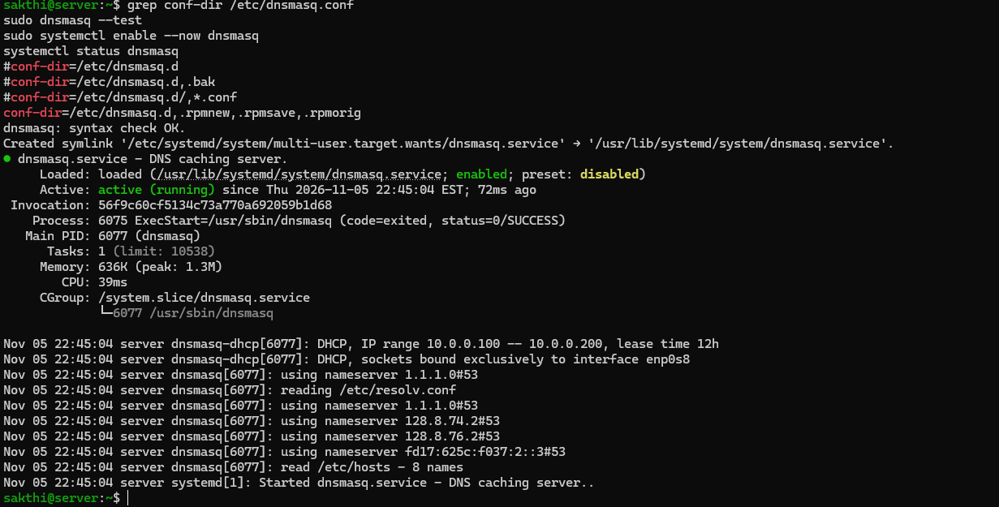

### 6. Client: just ask for DHCP
```bash
sudo nmcli con add type ethernet ifname enp0s3 con-name lab ipv4.method auto ipv6.method disabled
sudo nmcli con up lab
```
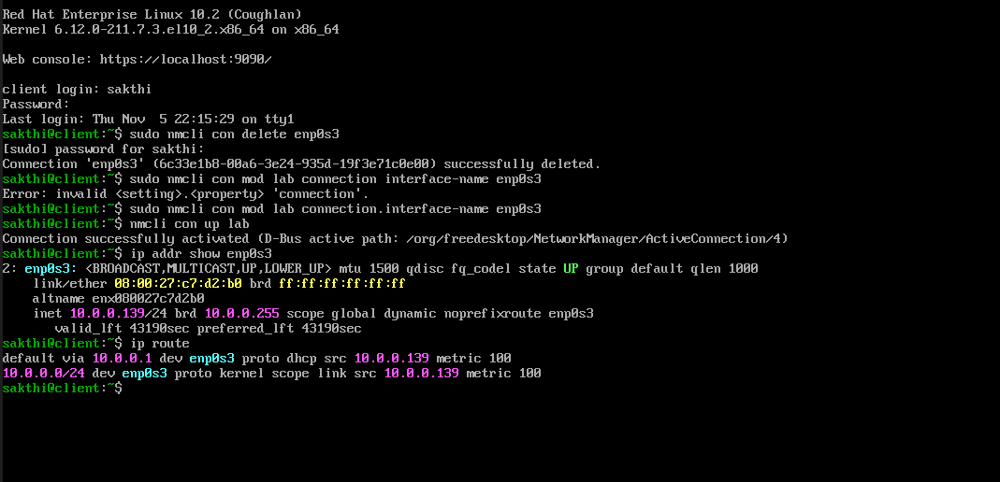

`client` got **10.0.0.139** with a **default route via 10.0.0.1**, both handed out by my own DHCP server.

---

## Proof it works

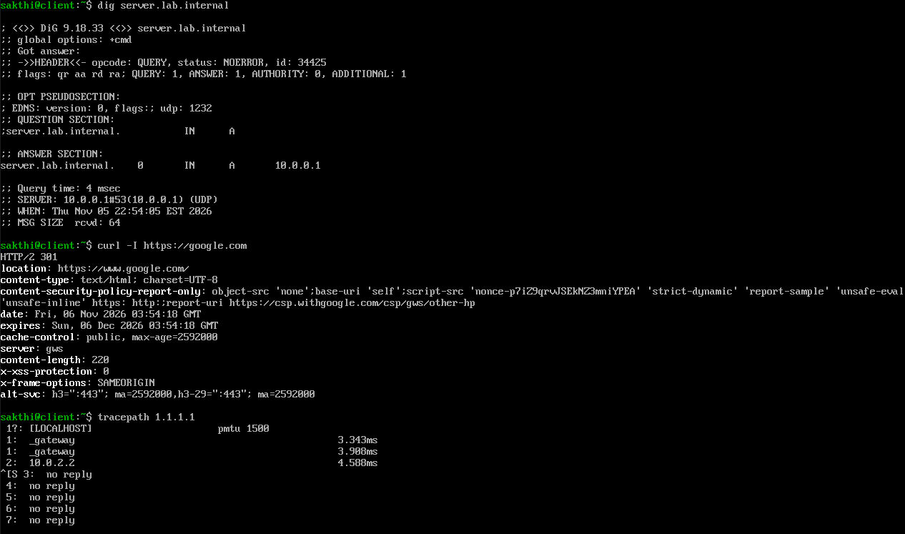

| Check | Result |
|---|---|
| `dig server.lab.internal` | `10.0.0.1`, answered by `SERVER: 10.0.0.1#53` (my dnsmasq) |
| `curl -I https://google.com` | `HTTP/2 301`: real internet, through `server`'s NAT |
| `tracepath 1.1.1.1` | hop 1 `_gateway` (10.0.0.1) → hop 2 `10.0.2.2` (VirtualBox NAT) → then silence |

**The silence after hop 2 isn't a failure.** VirtualBox's NAT doesn't pass back the ICMP "time exceeded" messages that tracepath depends on, so the path goes invisible even though traffic flows, as `curl` proves. "Traceroute shows nothing but the connection works" is a real-world puzzle, and now I know one reason it happens.

---

## Where it cracked


### A kernel update hid in my package install
Installing `kernel-modules-extra` (which provides `netem`) pulled in a **newer kernel** (`211.74.1`) while I was still running `211.7.3`, so the module wouldn't load until I rebooted. The same screenshot showed a second problem: **`enp0s8` didn't exist**, because I'd never enabled the second adapter on `server`.
**Fix:** enable Adapter 2 as Internal Network `labnet` and reboot. One reboot fixed both.

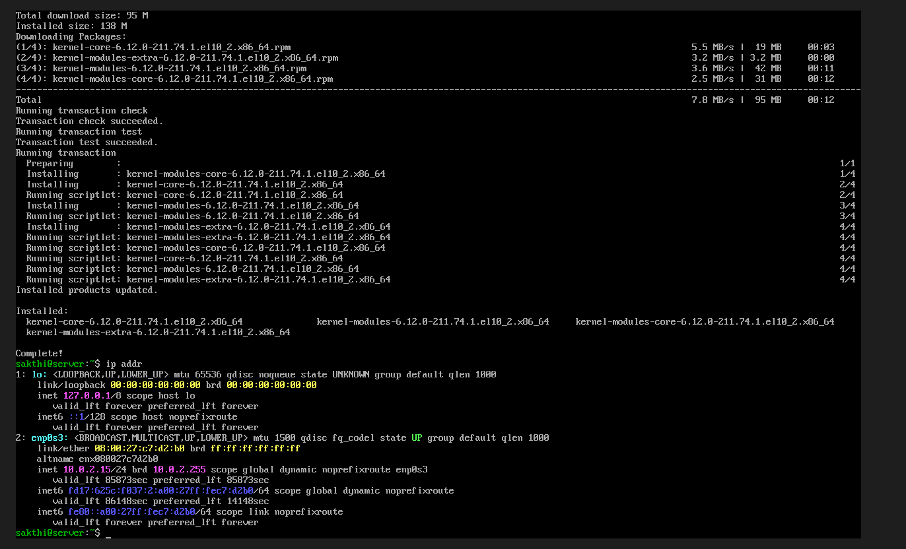
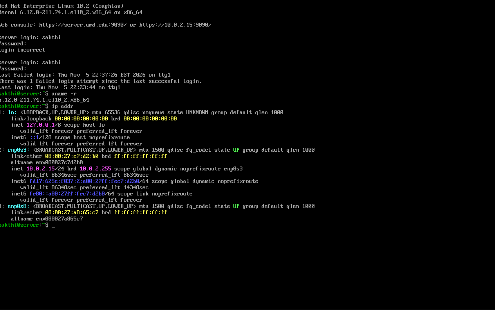

### SSH
I couldn't paste into the VirtualBox console, so I set up SSH from PowerShell through a NAT port forward. Didn't work at first because I forgot to apply the changes.

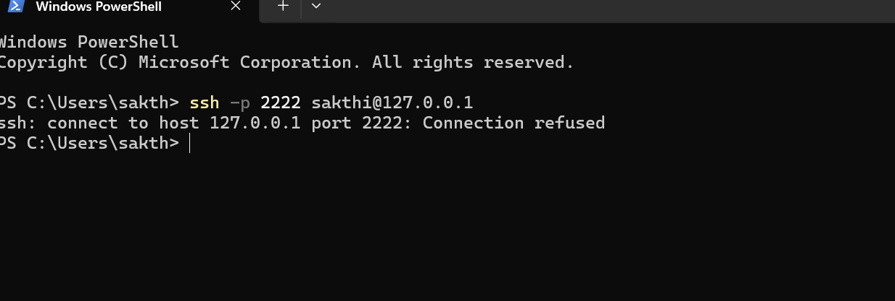
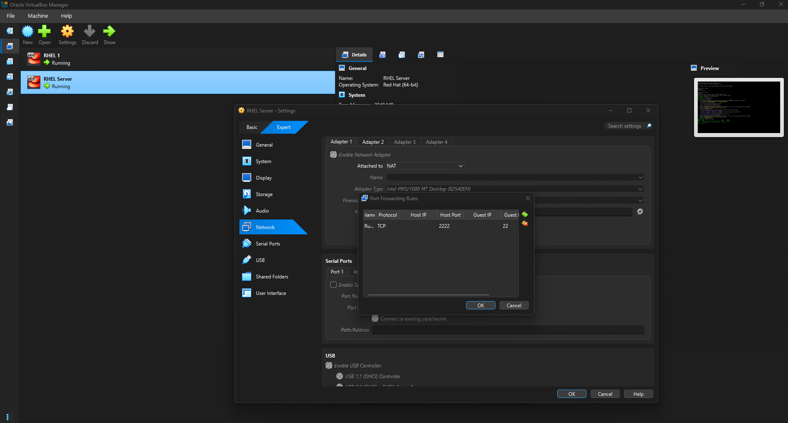

### firewalld rejected a combined command
```
firewall-cmd: error: argument --add-egress-zone: not allowed with argument --add-ingress-zone
```
**Fix:** run one policy option per command.

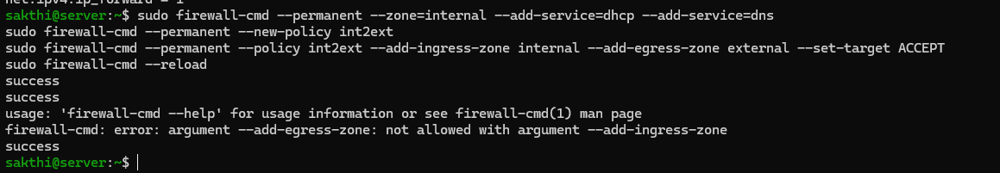

### 1.1.1.1 became 1.1.1.0
The dnsmasq log said `using nameserver 1.1.1.0#53`. Most likely a stray `Ctrl+X` in vi, which decrements the number under the cursor. DNS still worked, because dnsmasq also read UMD's resolvers from `/etc/resolv.conf`, which is exactly why I'd never have noticed without reading the logs.
**Fix:** `sed -i 's/server=1.1.1.0/server=1.1.1.1/'` and restart.
**Lesson:** a service that works can still be misconfigured. Read the startup logs, even when nothing looks wrong.

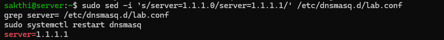

### Two connections named `lab`
One `nmcli` command got split across two lines, so the first half created a `lab` connection with default settings, and my corrected command created a second one.
**Fix:** `nmcli con delete lab` removed both, then I recreated one cleanly.

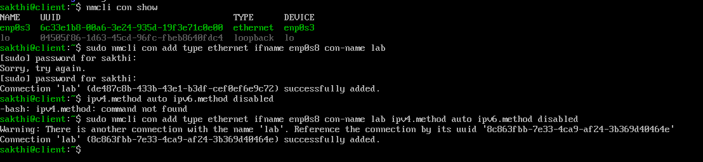

### Client had no `enp0s8`
```
Error: Connection activation failed: No suitable device found for this connection
```
`client` only had one network card, `enp0s3`, still attached to NAT. It was also quietly giving client its own internet connection, which would have bypassed `server` entirely.
**Fix:** reattach that adapter to `labnet`, delete the old NAT profile, and point `lab` at `enp0s3`.

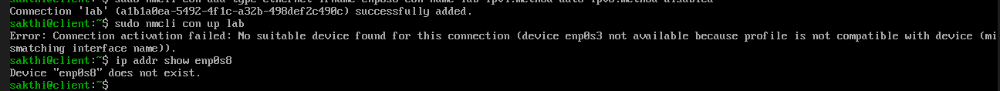
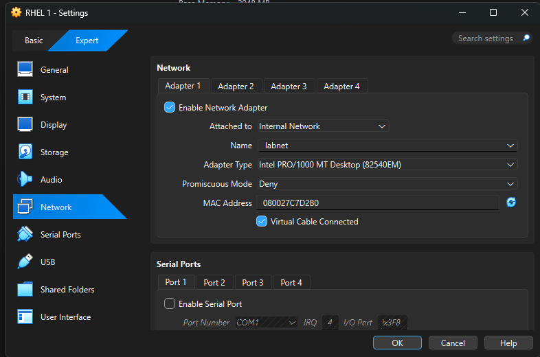

### Small cracks I left alone
- The clone kept `server`'s MAC address (`08:00:27:c7:d2:b0`). It's harmless because the two adapters sit on different networks, but it's not something to do on a real network.
- `server` shows up as `server.umd.edu`, because VirtualBox's NAT passed along my campus network's domain.


## The DHCP exchange

All four steps, captured on `server` after deleting `client`'s old lease so it had to start from scratch:

```bash
sudo tcpdump -l -n -v -i enp0s8 port 67 or port 68 | grep -E "^[0-9]|DHCP-Message"
```
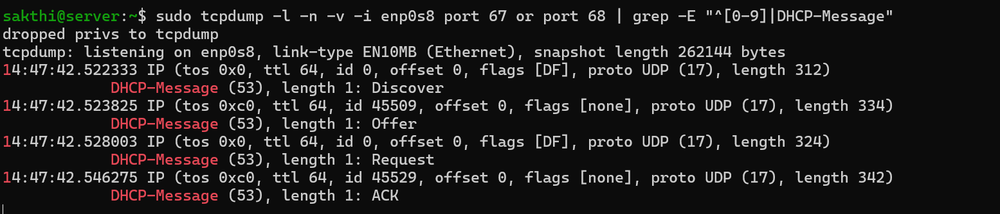

**Discover → Offer → Request → ACK** in about 24 milliseconds.
---

## Next Goals

- [ ] Regenerate `client`'s MAC address
- [ ] Read up on `rp_filter`, and when strict mode breaks things
- [ ] Break-and-fix challenges:
  - [ ] Remove `int2ext` and trace where packets stop
  - [ ] Turn off masquerade and inspect source IPs on `enp0s3`
  - [ ] Hand out a wrong router via DHCP
  - [ ] Compare a stopped DNS service with a firewall-blocked one
  - [ ] 10% packet loss with `netem`, and watch the retransmits
  - [ ] MTU mismatch

