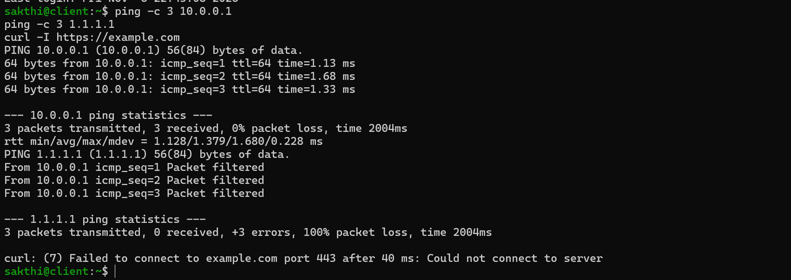
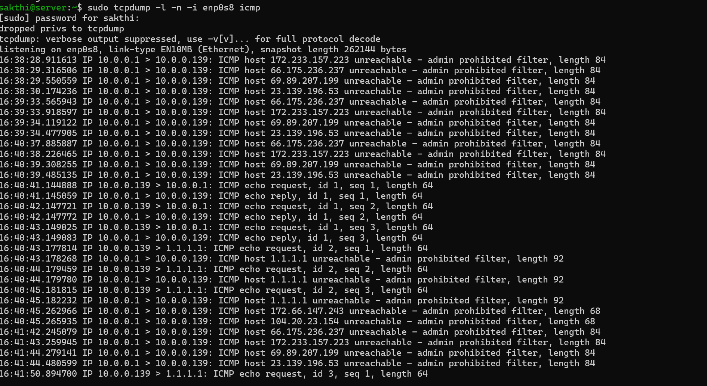
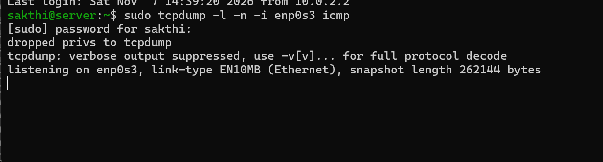
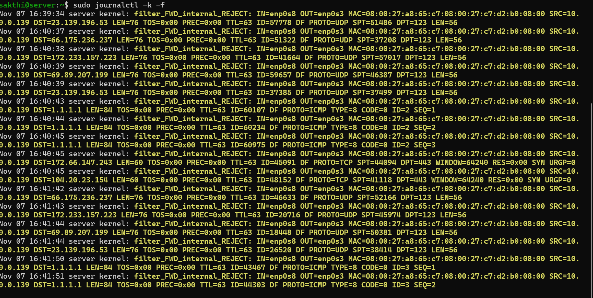
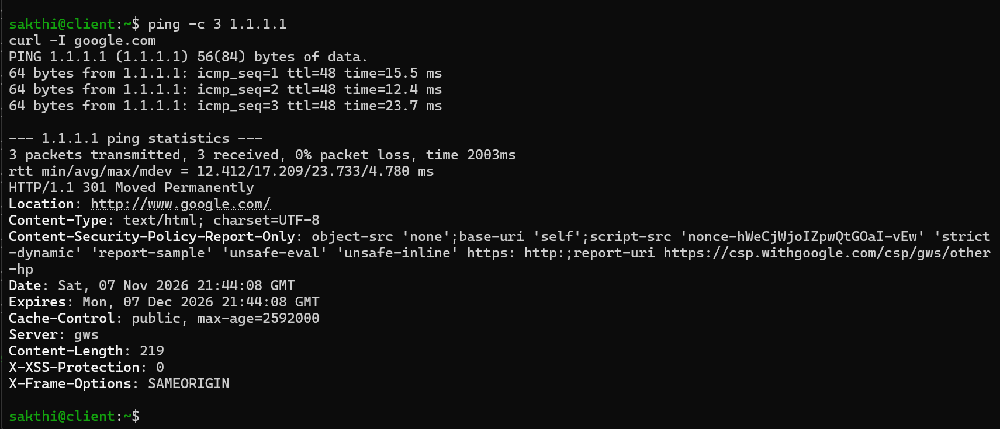
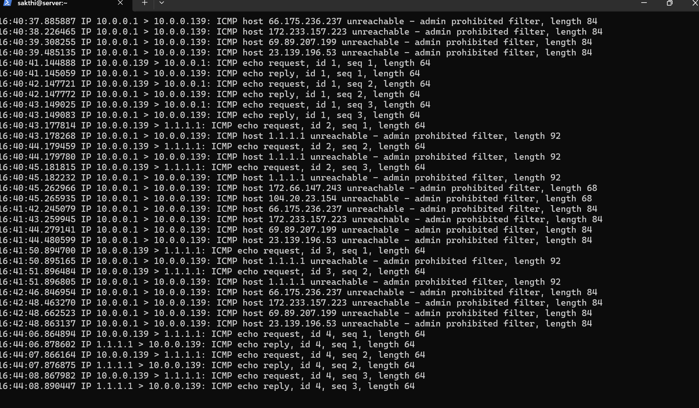
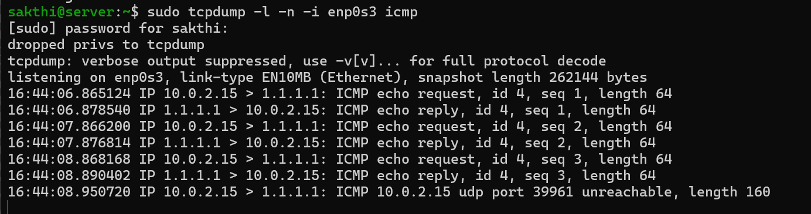
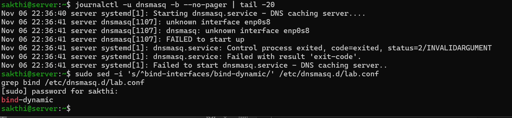
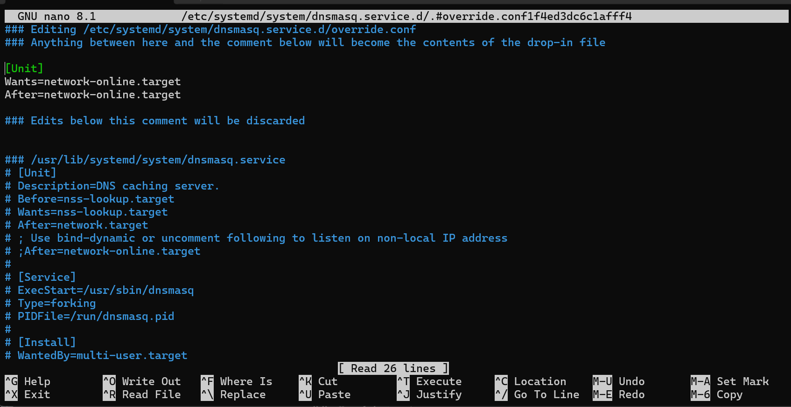
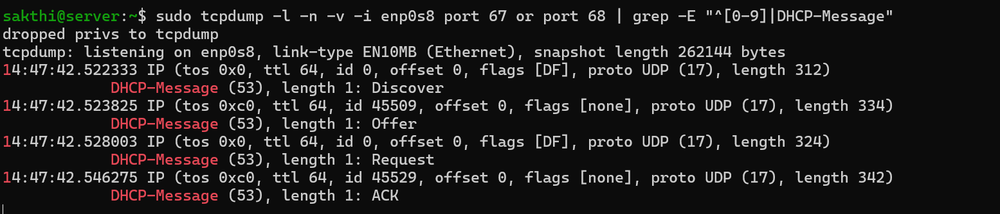

# Lab 01, Part 2: Break It on Purpose

> Part 1 built the network. Part 2 breaks it one piece at a time, to learn what each piece was actually doing.
>
> Before I broke anything on purpose, it broke on its own after a reboot. That's in here too.

---

## Challenge 1: Remove the forwarding policy

### The break
The `int2ext` policy is what allows lab traffic to pass through `server` to the internet. I disabled it by removing its egress zone, and turned on logging for every packet the firewall refuses:

```bash
sudo firewall-cmd --set-log-denied=all
sudo firewall-cmd --permanent --policy int2ext --remove-egress-zone external
sudo firewall-cmd --reload
```

Then I ran a packet capture on each side of `server`:

```bash
sudo tcpdump -l -n -i enp0s8 icmp     # lab side
sudo tcpdump -l -n -i enp0s3 icmp     # internet side
```

### Symptoms (from `client`)



| Test | Result |
|---|---|
| `ping 10.0.0.1` | ✅ works |
| `ping 1.1.1.1` | ❌ `From 10.0.0.1 icmp_seq=1 Packet filtered` |
| `curl -I https://example.com` | ❌ `Failed to connect ... after 40 ms` |

### Investigation

**1. Where do packets stop?**

The lab side shows client's pings arriving and `server` answering each one with a rejection:

```
10.0.0.139 > 1.1.1.1: ICMP echo request, id 2, seq 1
10.0.0.1 > 10.0.0.139: ICMP host 1.1.1.1 unreachable - admin prohibited filter
```



The internet side shows **nothing at all**. No packet ever leaves `server`.



**2. Why does pinging `server` still work?**
Traffic *to* `server` and traffic *through* `server` take different paths in the firewall. Packets addressed to `10.0.0.1` are checked against the `internal` zone, which allows them. Only **forwarded** traffic needs the `int2ext` policy, so only forwarded traffic broke.

**3. What does the firewall say?**



```
filter_FWD_internal_REJECT: IN=enp0s8 OUT=enp0s3 ... SRC=10.0.0.139 DST=1.1.1.1 ... TTL=63 ... PROTO=ICMP TYPE=8
```

| Field | What it means |
|---|---|
| `filter_FWD_internal_REJECT` | The forward path, from the `internal` zone: rejected |
| `IN=enp0s8 OUT=enp0s3` | The kernel had already chosen the outgoing interface. **Routing worked; the firewall blocked it.** |
| `TTL=63` | Client sent it with TTL 64, and server decremented it while routing |
| `TYPE=8` | ICMP echo request: my pings |

The log also showed what *else* `client` had been trying to do:
- `PROTO=UDP DPT=123`: **NTP**. Client's clock kept trying to sync with four time servers, retrying about every 65 seconds. These were the "mystery" rejections in the capture before I ran a single test.
- `PROTO=TCP DPT=443 SYN` to **two** addresses: `curl` trying each IP that `example.com` resolves to. Both were rejected immediately.

**4. Why did `curl` fail in 40 ms instead of hanging?**
firewalld **rejects** rather than silently dropping, so it sends client an ICMP "admin prohibited" message. Client knows right away that the connection failed. With a silent drop, `curl` would have hung until it timed out.

> Failing instantly points to a reject. Hanging points to a drop. The timing alone narrows down the cause.

**A subtle detail:** DNS kept working the whole time. `curl` resolved `example.com` without a problem, because client asks `server`'s dnsmasq (traffic *to* server, allowed), and dnsmasq looks up the answer from `server` itself (server's own outbound traffic, not forwarded). **"DNS resolves but I can't connect" is a strong hint the problem is forwarding or the firewall, not DNS.**

### The fix

```bash
sudo firewall-cmd --permanent --policy int2ext --add-egress-zone external
sudo firewall-cmd --reload
sudo firewall-cmd --set-log-denied=off
```

### After the fix



Pings to `1.1.1.1` get replies, and `curl` returns a real HTTP response. Both captures now show traffic, and comparing them shows **NAT in action**:

| Interface | Same packet (`id 4, seq 1`) | Time |
|---|---|---|
| `enp0s8` (lab side) | `10.0.0.139 > 1.1.1.1` | `16:44:06.864894` |
| `enp0s3` (internet side) | `10.0.2.15 > 1.1.1.1` | `16:44:06.865124` |

It's the same packet, with the source address rewritten from client's to server's, about **0.2 ms** later. The NTP rejections stopped too.




**A stray line:** right after the pings, the internet side showed `10.0.2.15 > 1.1.1.1: ICMP udp port 39961 unreachable`, meaning *server* telling 1.1.1.1 that a port was closed. My best explanation: when `curl` looked up `google.com`, dnsmasq asked more than one upstream DNS server, took the first answer, and closed the socket. When 1.1.1.1's answer arrived later, nothing was listening anymore. It's harmless.

---

## Where it cracked (Part 2)

### It worked until I rebooted
After rebooting `server`, dnsmasq was dead:

```
dnsmasq[1107]: unknown interface enp0s8
dnsmasq[1107]: FAILED to start up
```



**Cause:** a startup race. dnsmasq started about a second into boot, **before `enp0s8` existed**. The kernel was still detecting and naming the network cards. With `bind-interfaces`, dnsmasq requires the interface to exist at startup, so it gave up.

The knock-on effect: `client` booted, got no DHCP answer, and NetworkManager gave up on the `lab` connection. One service failing at boot broke a different machine.

**Fix, two ways:**
1. Let dnsmasq handle interfaces that appear later. In `lab.conf`, change `bind-interfaces` to `bind-dynamic`.
2. Make it wait for the network, with a systemd drop-in (`sudo systemctl edit dnsmasq`):
   ```ini
   [Unit]
   Wants=network-online.target
   After=network-online.target
   ```

The original unit file already had a comment, roughly *"Use bind-dynamic or uncomment following to listen on non-local IP address,"* above a commented-out `After=network-online.target`. The packagers knew about this exact problem.



**Lesson:** "it works when I start it by hand" isn't the same as "it works at boot." Always test with a reboot. And read the unit file, because sometimes the answer is already written in it.

### A typo that looked like an outage
`systemctl is-active dnsmasqe` returned `inactive`. That service doesn't exist, and systemctl reports nonexistent units as inactive rather than as an error. The real check, `dnsmasq`, returned `failed`, which led to the boot problem above.

### The wildcard that wouldn't expand
```
sudo rm /var/lib/NetworkManager/internal-*.lease
rm: cannot remove '...internal-*.lease': No such file or directory
```
The files existed. **My shell**, running as my normal user, expands the `*` before `sudo` ever runs. My user can't read that directory, so the shell passed the literal text `internal-*.lease` to `rm`.
**Fix:** let root's shell do the expansion: `sudo sh -c 'rm -f /var/lib/NetworkManager/internal-*.lease'`

### Pressing Enter inside an open quote
I pressed Enter partway through the `sh -c '...'` command. The quote was still open, so the shell kept reading on a new line, and `sh` received two separate commands: `rm -f` with no file, then the lease filename on its own, which it tried to **run as a program** (`Permission denied`). Nothing was deleted.

### DHCP had two forms
The first capture showed only **Request then ACK**. Client remembered its old lease and asked to keep it, skipping Discover and Offer. After deleting the lease, I got the full exchange:



### Missing last line in a piped capture
`tcpdump ... | grep` showed Discover, Offer, and Request, but no ACK. When tcpdump's output goes into a pipe, it buffers lines instead of printing each one immediately.
**Fix:** `tcpdump -l` for line-buffered output. A missing last line in piped output is usually buffering, not lost data.

### The clone shared server's SSH identity
Connecting to `client` (through `server`, with `ssh -J`), SSH warned:
```
This host key is known by the following other names/addresses:
    [127.0.0.1]:2222
```
The clone had copied `server`'s **SSH host keys**. Host keys are how SSH proves it's talking to the right machine. Two machines sharing one means SSH can't tell them apart, which undermines its protection against an attacker impersonating a server.
**Fix:**
```bash
sudo rm /etc/ssh/ssh_host_*
sudo ssh-keygen -A
sudo systemctl restart sshd
```
Then remove the old saved key on Windows with `ssh-keygen -R 10.0.0.139`.

Along with the machine ID, registration, and MAC address, that's the fourth piece of identity the clone carried over.

---

## Still unfinished

- [x] ~~Challenge 1: remove `int2ext` and trace where packets stop~~
- [ ] Challenge 2: turn off masquerade and inspect source IPs on `enp0s3`
- [ ] Challenge 3: hand out a wrong router via DHCP
- [ ] Challenge 4: stopped DNS service vs. firewall-blocked DNS
- [ ] Challenge 5: 10% packet loss with `netem`
- [ ] Challenge 6: MTU mismatch
- [ ] Regenerate `client`'s MAC address
- [ ] Read up on `rp_filter`
