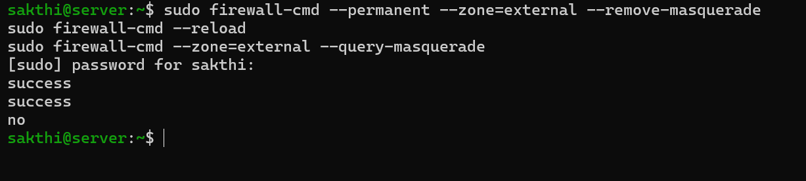
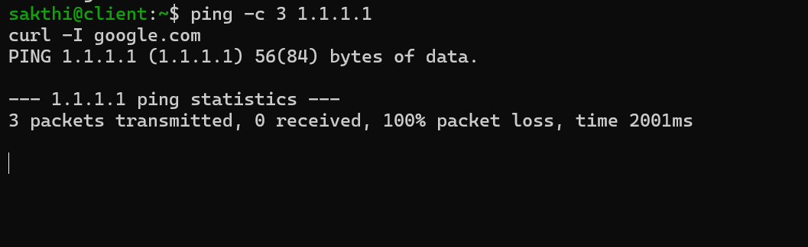
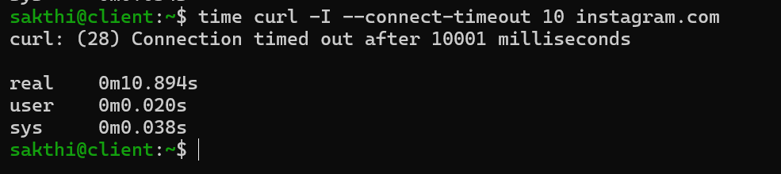
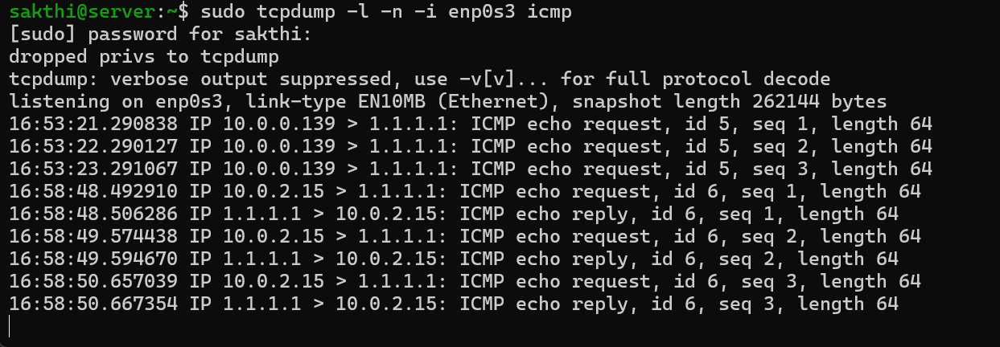
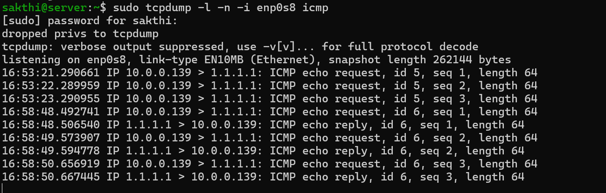
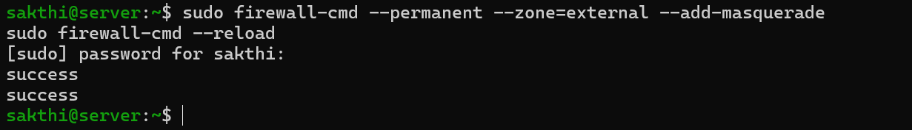
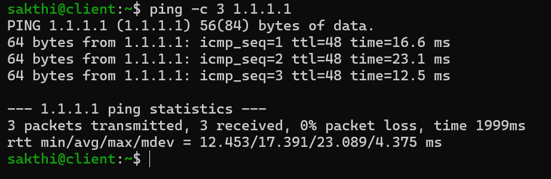

# Challenge 2: Turn Off NAT

> Challenge 1 broke **routing**: packets never left `server`. This one breaks **translation**: packets leave just fine, and the replies can't find their way back.

← [Lab 01](lab1.md) · [Challenge 1](challenge1.md)

---

## The break

The `external` zone's masquerade is what rewrites `client`'s private address to `server`'s address on the way out. I turned it off:

```bash
sudo firewall-cmd --permanent --zone=external --remove-masquerade
sudo firewall-cmd --reload
sudo firewall-cmd --zone=external --query-masquerade    # → no
```



Packet captures on both sides of `server`:

```bash
sudo tcpdump -l -n -i enp0s8 icmp     # lab side
sudo tcpdump -l -n -i enp0s3 icmp     # internet side
```

---

## Symptoms (from `client`)

```
3 packets transmitted, 0 received, 100% packet loss
```



No `Packet filtered`, no error at all. The pings just vanish.

```
curl: (28) Connection timed out after 10001 milliseconds
real    0m10.894s
```



| | Challenge 1 (no forwarding) | Challenge 2 (no NAT) |
|---|---|---|
| curl error | `(7)` connection failed, **40 ms** | `(28)` timed out, **10 s** |
| Meaning | Something **refused** the connection | **Nothing answered** at all |
| Client sees | `Packet filtered` | Silence |

In Challenge 1 the firewall rejected the packets and *told* client. This time nothing rejects anything, so client hears nothing back, TCP keeps resending, and curl eventually gives up.

The extra ~0.9 s on top of the 10-second timeout was the DNS lookup. **DNS still worked**, because client asks `server`, and server's own lookups don't need NAT. Same pattern as Challenge 1: names resolve, connections fail.

---

## Investigation

The internet-side capture shows the whole challenge in one screenshot: NAT off, then NAT back on, a few minutes apart.



```
16:53:21  10.0.0.139 > 1.1.1.1: ICMP echo request, id 5, seq 1    ← NAT off: no reply
16:53:22  10.0.0.139 > 1.1.1.1: ICMP echo request, id 5, seq 2
16:53:23  10.0.0.139 > 1.1.1.1: ICMP echo request, id 5, seq 3
16:58:48  10.0.2.15  > 1.1.1.1: ICMP echo request, id 6, seq 1    ← NAT on
16:58:48  1.1.1.1    > 10.0.2.15: ICMP echo reply,  id 6, seq 1
```

**With NAT off, packets left `server` carrying client's private address, `10.0.0.139`.** Server still *routed* them (the `int2ext` policy allows it), but it no longer *translated* them.

**Why nothing came back:** `10.0.0.139` is a private address, which anyone can use inside their own network, so the outside world has no route back to it. In this lab, the next hop is VirtualBox's NAT, which only knows its own `10.0.2.0/24` network. It has no idea `10.0.0.0/24` exists behind `server`, so replies have nowhere to go. On a real network, the ISP would simply drop packets with a private source address.

The lab-side capture tells the other half:



| | Lab side (`enp0s8`) | Internet side (`enp0s3`) |
|---|---|---|
| **NAT off (id 5)** | `10.0.0.139 > 1.1.1.1`, no reply | `10.0.0.139 > 1.1.1.1`, no reply |
| **NAT on (id 6)** | `10.0.0.139 > 1.1.1.1`, **reply to `10.0.0.139`** | `10.0.2.15 > 1.1.1.1`, **reply to `10.0.2.15`** |

**NAT is invisible to `client`.** On the lab side, both pings look identical: client is always `10.0.0.139`, talking directly to `1.1.1.1`. With NAT on, `server` rewrites the address in **both directions**: outgoing `10.0.0.139` becomes `10.0.2.15`, and the reply to `10.0.2.15` is translated back to `10.0.0.139`. Linux keeps track of which translated connection belongs to which lab machine (connection tracking, or *conntrack*) so it can do that.

> Capture on both sides of a router. Either side alone tells you half the story: the lab side looks the same whether NAT works or not.

---

## The fix

```bash
sudo firewall-cmd --permanent --zone=external --add-masquerade
sudo firewall-cmd --reload
```




---

## Where it cracked

### The captures that showed nothing
On the first run, **both** captures were empty, including the lab side. That shouldn't happen: tcpdump sees packets as they arrive, *before* the firewall, so client's pings should appear on `enp0s8` whatever NAT is doing.

An empty capture meant either the pings never reached `server`, or the capture wasn't running when I pinged. Re-running with both captures visibly up showed it was timing: I'd pinged before the captures started.

**Lesson:** start the captures *first*, then generate traffic. And when a capture is unexpectedly empty, confirm the capture works (`ping 10.0.0.1` should always show up) before concluding anything about the network.

---

## Challenges 1 and 2 together

| | Challenge 1 | Challenge 2 |
|---|---|---|
| What I broke | Forwarding policy | NAT (masquerade) |
| Packet leaves `enp0s3`? | ❌ rejected inside `server` | ✅ with source `10.0.0.139` |
| Where it fails | Server's firewall | The return path: no route to a private address |
| How it fails | Loudly: instant rejection | Silently: timeout |

**Routing gets packets out. NAT gets the replies back.** A home router needs both.
