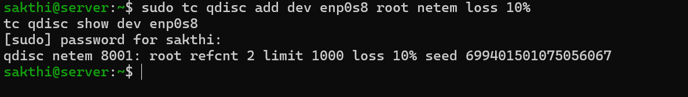
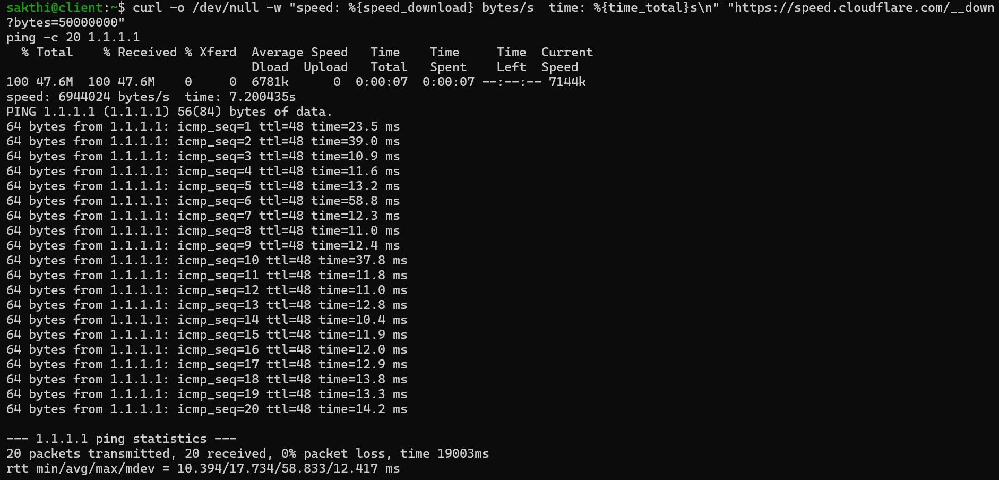
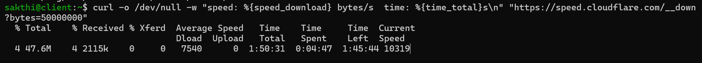
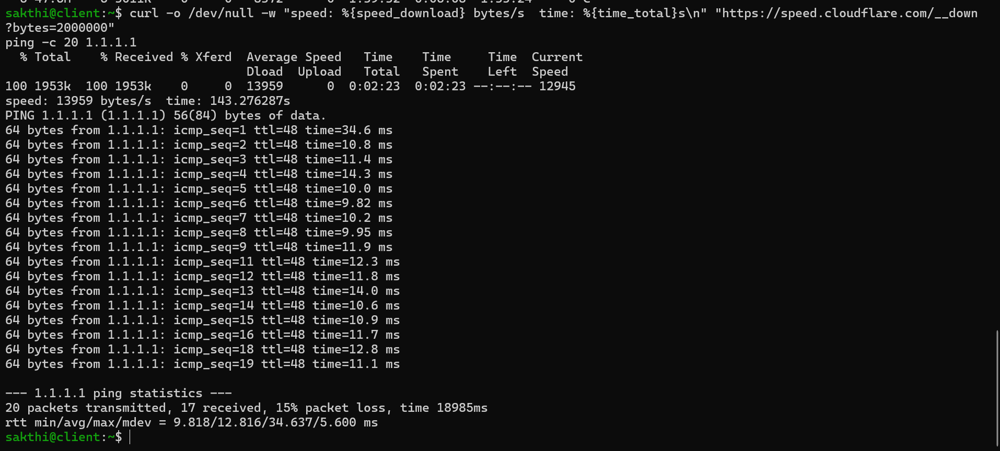
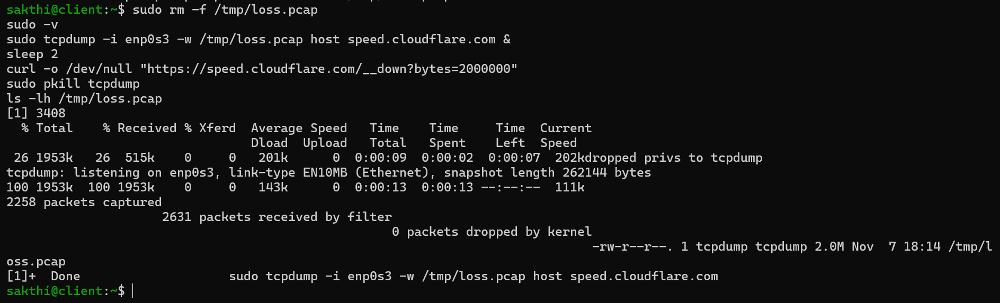
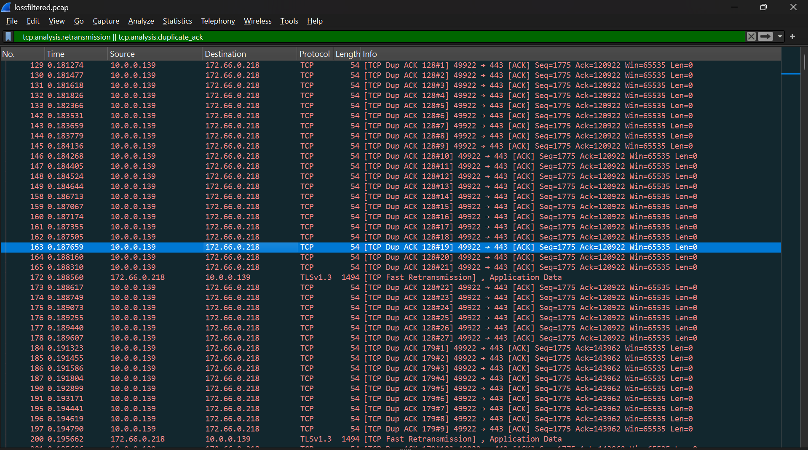
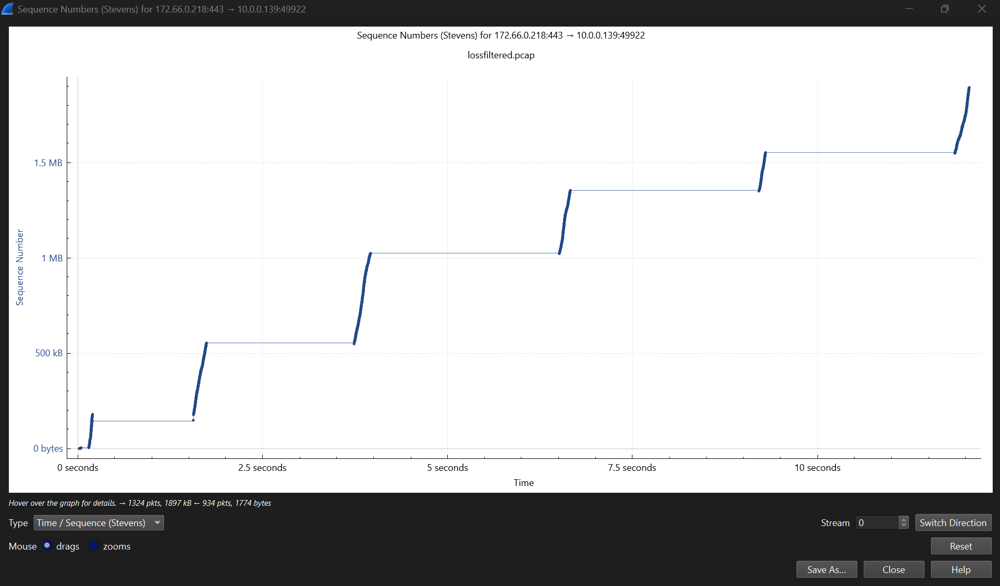
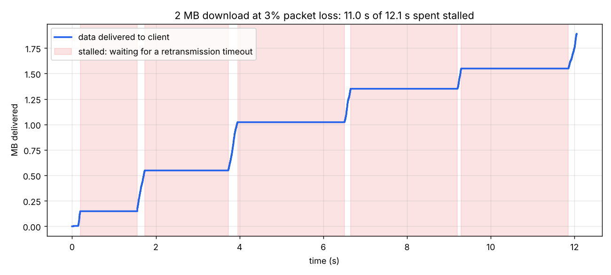
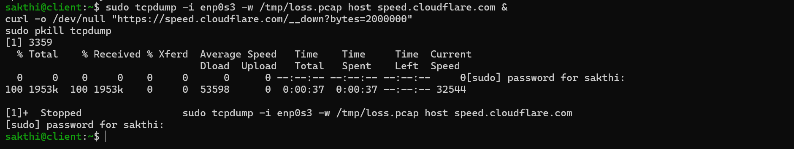
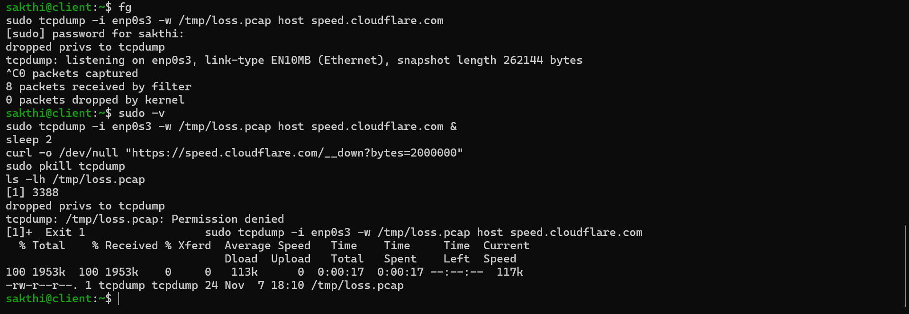

# Challenge 3: Packet Loss

> Challenges 1 and 2 broke the network outright. This one only makes it *unreliable*: a small share of packets just disappear. It turned out to be the most dramatic result so far.

← [Lab 01](lab1.md) · [Challenge 1](challenge1.md) · [Challenge 2](challenge2.md)

---

## The break

`tc` with `netem` (network emulator) adds impairments to an interface. I dropped a percentage of the packets leaving `server` toward `client`, which is the direction download data travels:

```bash
sudo tc qdisc add dev enp0s8 root netem loss 10%
tc qdisc show dev enp0s8
# qdisc netem 8001: root refcnt 2 limit 1000 loss 10% seed 699401501075056067
```



To change the loss rate: `sudo tc qdisc change dev enp0s8 root netem loss 1%`. To remove it: `sudo tc qdisc del dev enp0s8 root`.

The loss only applies to packets *leaving* `server` on `enp0s8`. Client's ACKs back to the sender aren't affected.

---

## Results

### Baseline (no loss)



A 50 MB download ran at **~6.9 MB/s (7.2 s)**. Ping had **0% loss**, about 18 ms average.

### 10% loss on the same 50 MB download



| | No loss | 10% loss |
|---|---|---|
| Speed | 6,944,024 bytes/s | **7,540 bytes/s** |
| Time for 50 MB | 7.2 s | **~1 h 50 min** (estimated; I stopped it) |

**10% packet loss didn't make the download 10% slower. It made it about 900 times slower.**

### The same 2 MB file at each loss rate

| Loss | Speed | Time | Compared to no loss |
|---|---|---|---|
| **0%** | ~3.2 MB/s | **0.62 s** | — |
| **1%** | ~109 KB/s | **18.4 s** | ~30× slower |
| **3%** | 54–143 KB/s | **13–37 s** (three runs) | ~20–60× slower |
| **10%** | ~14 KB/s | **143 s** | ~230× slower |

```
0%:   speed: 3216918 bytes/s  time: 0.621713s
1%:   speed: 108607 bytes/s   time: 18.414965s
10%:  speed: 13959 bytes/s    time: 143.276287s
```



**Even 1% loss made the download about 30 times slower.** And the 3% runs ranged from 13 to 37 seconds. Netem drops packets at random, so each run loses *different* packets, and a few unlucky drops can double the time.

(The 0% speed for 2 MB, 3.2 MB/s, is lower than the 50 MB baseline because on a short download, more of the time goes to TCP's ramp-up at the start.)

### Ping vs. TCP

With 10% loss, ping lost **3 of 20** packets (`seq` 10, 17, and 20 missing): 15% loss, about what you'd expect from chance with only 20 pings. The pings that *did* arrive had normal round-trip times (~12 ms).

**Ping just skips lost packets.** ICMP has no idea of delivery or resending, so a lost ping is simply gone. **TCP has to deliver every byte, in order,** so it stops to recover each loss. The same packet loss looks like "15% loss" to ping and "230× slower" to a download.

---

## Investigation: why so much worse than 10%?

I captured a 2 MB download at **3% loss** on `client` and opened it in Wireshark.

```bash
sudo tcpdump -i enp0s3 -w /tmp/loss.pcap host speed.cloudflare.com &
sleep 2
curl -o /dev/null "https://speed.cloudflare.com/__down?bytes=2000000"
sudo pkill tcpdump
```



### 1. Retransmissions match the loss I set
Out of **1,319** data packets from the server, **43** were retransmissions: **3.3%**. I told netem to drop 3%, and that's almost exactly what TCP had to resend.

### 2. Duplicate ACKs point at each gap
Client sent **227 duplicate ACKs** in **41 bursts**.



```
Dup ACK 128#1 ... #21   Ack=120922   "I'm still missing the data starting at byte 120922"
172  TCP Fast Retransmission          ← the sender resends exactly that piece
```

Each duplicate ACK means "I got more data, but there's still a gap at this point." Enough of them trigger **fast retransmit**: the sender resends the missing piece without waiting for a timeout. Fast retransmit normally starts after **3** duplicate ACKs. Here it took **21**, because the sender reacted late (see the VirtualBox note below).

### 3. No SACK
Client never sent **SACK** (selective acknowledgment) blocks. With SACK, the receiver can report *every* gap at once. Without it, the sender learns about one missing piece per round trip, so several losses close together recover slowly. My capture missed the handshake where SACK is negotiated, but if it had been agreed on, client's duplicate ACKs would carry SACK blocks, and none do.

### 4. Most of the download was spent waiting



Wireshark's Stevens graph (**Statistics → TCP Stream Graphs → Stevens**) plots data delivered over time. The flat steps are stalls where no new data arrived.



| Stall | Duration |
|---|---|
| 0.20 → 1.56 s | 1.36 s |
| 1.74 → 3.73 s | 1.99 s |
| 3.96 → 6.51 s | 2.55 s |
| 6.66 → 9.20 s | 2.55 s |
| 9.29 → 11.85 s | 2.56 s |
| **Total** | **11.0 s of 12.05 s (91%)** |

Each stall ends with a resend of exactly the piece client had been asking for. In the ~1 second of active time, data moved at close to normal speed.

**The slowdown isn't from retransmitting data. It's from waiting for timeouts.** When fast retransmit can't happen, for example at 3.95 s, where client sent only **2** duplicate ACKs (not enough to trigger it), the sender waits for a full **retransmission timeout** before resending. These timeouts were about **2.5 seconds** each.

### The VirtualBox factor
VirtualBox's NAT doesn't just pass TCP through. It ends each connection itself and opens a new one to the real server. So the TCP sender talking to my lab was VirtualBox's built-in networking code, not Cloudflare's servers. That would explain three things in the capture:
- **no SACK**
- fast retransmit only after **21** duplicate ACKs instead of 3
- **~2.5 s** timeouts, far longer than modern Linux's 200 ms minimum

A modern sender would recover better. Even so, the general lesson holds: **throughput collapses much faster than packet loss grows**, because each loss that can't be fixed quickly costs a timeout, measured in seconds rather than milliseconds.

---

## The fix

```bash
sudo tc qdisc del dev enp0s8 root
tc qdisc show dev enp0s8     # back to the default (fq_codel)
```

---

## Where it cracked

### The capture paused itself
```
[1]+  Stopped    sudo tcpdump -i enp0s3 -w /tmp/loss.pcap ...
```


`sudo` needed my password, but tcpdump was running **in the background** (`&`), and background programs can't read from the keyboard. Linux paused it, so curl ran with nothing capturing.
**Fix:** run `sudo -v` first. It asks for the password once and remembers it for a few minutes, so the background command doesn't need to ask.

### Permission denied on a file I'd just created


Resuming the paused capture with `fg` left a nearly empty `/tmp/loss.pcap` (24 bytes) **owned by the `tcpdump` user**. The next tcpdump couldn't reopen it: `Permission denied`. Most likely this is `fs.protected_regular = 1` (visible in my sysctl output back in Lab 01), which blocks opening files in shared directories like `/tmp` that a different user owns. It exists to stop one user from tricking another into writing to a planted file.
**Fix:** `sudo rm -f /tmp/loss.pcap`, then capture again.

### The capture started late
tcpdump printed "listening" after curl was already 26% done, so the capture missed the start of the download, including the TCP handshake. It didn't matter for finding retransmissions, but it's why I couldn't directly see whether SACK was negotiated.

### My "filtered" capture was identical to the original
`lossfiltered.pcap` was byte-for-byte the same as `loss.pcap`. A Wireshark display filter only changes what's *shown*. To save just the filtered packets, use **File → Export Specified Packets → Displayed**.

### My own SSH session suffered too
My SSH session to `client` crosses `enp0s8`, so it lost packets as well, and typing lagged. SSH runs over TCP, so it kept working, just slower: a small, live example of the same effect.

---

## Takeaways

- **1% packet loss made a download ~30× slower.** 10% made it ~230× slower.
- **TCP's slowdown comes from waiting, not resending.** 91% of the captured download was spent stalled on timeouts.
- **Fast retransmit** (duplicate ACKs) recovers in milliseconds. **Timeouts** take seconds. How often loss forces a timeout decides throughput.
- **Ping and TCP see the same loss very differently.** Ping skips lost packets; TCP must recover every byte.
- **Test results through VirtualBox's NAT aren't the same as real-world TCP.** Knowing what's actually doing the sending matters when interpreting a capture.
