# Challenge 4: MTU mismatch
> I shrank one link and nothing broke. I shrank another and the network card froze. The third try finally made a black hole, and the first thing to fall into it was the TLS handshake.

This challenge covers MTU, fragmentation, the DF ("don't fragment") bit, path MTU discovery (PMTUD), PMTUD black holes, TCP MTU probing, and MSS clamping. MSS clamping is exactly what the WireGuard tunnel in Phase 2 will need, since WireGuard's default MTU is 1420.

### Baseline (from `client`)

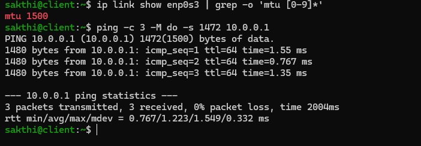
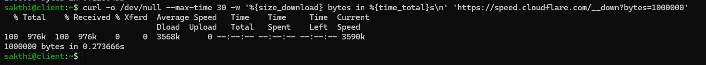

| Test | Result |
|---|---|
| `ip link show enp0s3` | `mtu 1500` |
| `ping -c 3 -M do -s 1472 10.0.0.1` (1500 bytes total, DF set) | ✅ 3/3, 1480 bytes back |
| `curl -I https://example.com` | ✅ `HTTP/2 200` |
| 1 MB download from `speed.cloudflare.com` | ✅ 1,000,000 bytes in **0.27 s** |

`-M do` sets DF, so the packet can't be split along the way. 1472 bytes of data plus 28 bytes of IP and ICMP headers is exactly 1500.

---

## Part 1: Shrink the lab side

### The break

```bash
sudo ip link set dev enp0s8 mtu 1200
```

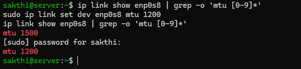

With a capture on each side of `server`:

```bash
sudo tcpdump -l -n -i enp0s3 icmp                                          # internet side
sudo tcpdump -l -n -i enp0s8 'icmp or (tcp[tcpflags] & tcp-syn != 0)'     # lab side, plus TCP handshakes
```

### Symptoms (from `client`)

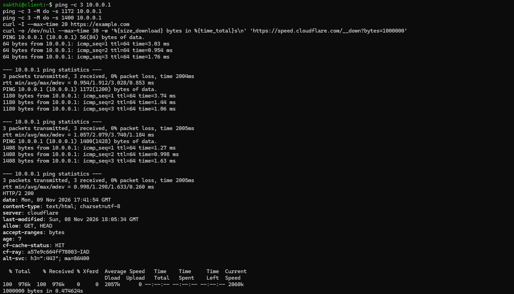

| Test | Result |
|---|---|
| `ping 10.0.0.1` | ✅ works |
| `ping -M do -s 1172 10.0.0.1` (exactly 1200) | ✅ 1180 bytes back |
| `ping -M do -s 1400 10.0.0.1` (1428, too big) | ✅ **1408 bytes back** |
| `curl -I https://example.com` | ✅ `HTTP/2 200` |
| 1 MB download | ✅ 0.47 s |

**Nothing broke.**

### Investigation

**1. How did a 1428-byte packet fit through a 1200-byte link?**

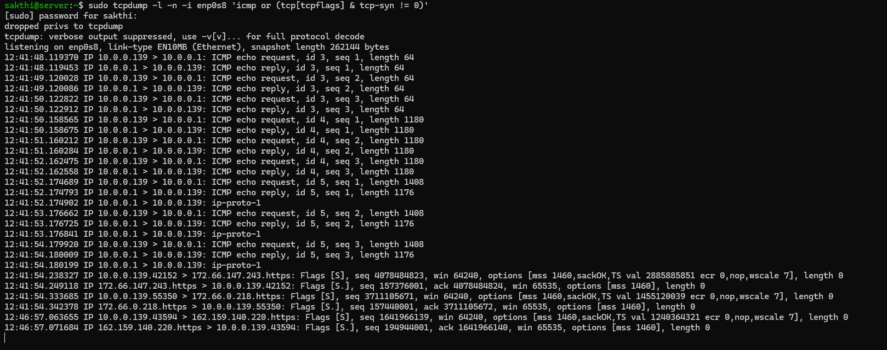

```
10.0.0.139 > 10.0.0.1: ICMP echo request, id 5, seq 1, length 1408
10.0.0.1 > 10.0.0.139: ICMP echo reply, id 5, seq 1, length 1176
10.0.0.1 > 10.0.0.139: ip-proto-1
```

- The 1408-byte request arrived whole. **MTU limits what an interface sends, not what it accepts.**
- The reply left in **two pieces**. The first carries 1176 bytes (1200 − 20 bytes of IP header = 1180, rounded down to a multiple of 8, because fragment offsets count in 8-byte units). The second piece has no ICMP header, so tcpdump can only call it `ip-proto-1` ("IP protocol 1"). Client put them back together, and ping printed "1408 bytes" without knowing anything had been split.

**2. Did TCP know about the limit?**

```
10.0.0.139.42152 > 172.66.147.243.https: Flags [S], ... options [mss 1460,sackOK,TS ...,nop,wscale 7]
172.66.147.243.https > 10.0.0.139.42152: Flags [S.], ... win 65535, options [mss 1460], length 0
```

No. Both sides agreed on 1460-byte segments, which means full 1500-byte packets. The SYN-ACK has only an MSS option (no SACK, timestamps or window scaling) and a flat `win 65535`. That's consistent with **VirtualBox NAT answering the handshake itself**, the same "no SACK" finding as Challenge 3. Likely, not proven.

**3. Did server complain to anyone?**

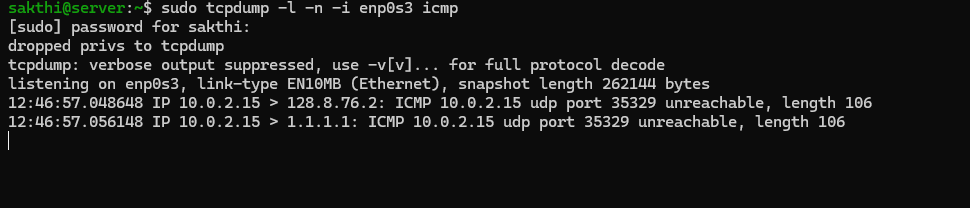

No "fragmentation needed" messages went out at all. (The two `udp port 35329 unreachable` lines are a separate DNS quirk, covered in "Still unfinished.")

**4. So what happened to the 1 MB download?**

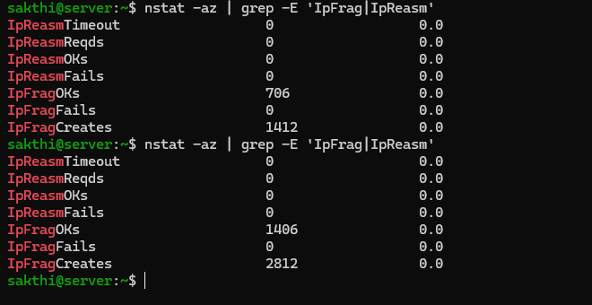

| Counter (`nstat -az` on `server`) | Before | After 1 MB download | Change |
|---|---|---|---|
| `IpFragOKs` | 706 | 1406 | **+700** |
| `IpFragCreates` | 1412 | 2812 | **+1400** |
| `IpFragFails` | 0 | 0 | 0 |

**700 packets, each split into exactly 2 pieces.** Every full-size segment was too big for 1200 and small enough for two fragments. The "before" value of 706 is the earlier download plus the three fragmented ping replies.

`IpFragFails = 0` with no "fragmentation needed" messages means the incoming packets had **no DF bit**, because Linux can only fragment a forwarded packet when DF is off. That's inferred from the counters; I didn't capture the flags directly.

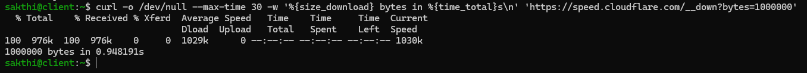

Downloads at 1200 took 0.47 s and 0.95 s, against 0.27 s at 1500. With one run each, I'm not blaming fragmentation for that.

> A narrow link without DF isn't broken, just quietly doing extra work. Nothing in the client's view even hints at it.

---

## Part 2: Shrink the internet side

### The break (first try)

```bash
sudo ip link set dev enp0s3 mtu 1200
```

The network card froze and took my SSH sessions with it. That's in "Where it cracked."

### The break (second try)

Changing a NIC's MTU resets the card. Changing a **route's** MTU doesn't touch any hardware:

```bash
sudo ip route change default via 10.0.2.2 dev enp0s3 proto dhcp src 10.0.2.15 metric 102 mtu lock 1200
```

- `metric 102` has to match the existing route (copied from `ip route show default`), or `ip route change` can't find it.
- `lock` is what makes the route MTU apply to **forwarded** traffic, not just server's own.

### Symptoms (from `client`)

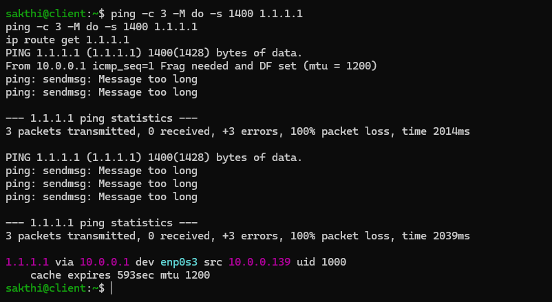

```
PING 1.1.1.1 (1.1.1.1) 1400(1428) bytes of data.
From 10.0.0.1 icmp_seq=1 Frag needed and DF set (mtu = 1200)
ping: sendmsg: Message too long
ping: sendmsg: Message too long
```

| Packet | Result |
|---|---|
| 1 | ❌ `server` answers: fragmentation needed, MTU 1200 |
| 2, 3 | ❌ `sendmsg: Message too long`: **never left client** |
| Second run, all 3 | ❌ refused by client's own kernel |

```
1.1.1.1 via 10.0.0.1 dev enp0s3 src 10.0.0.139 uid 1000
    cache expires 593sec mtu 1200
```

### Investigation

**1. How many oversized packets reached server?**

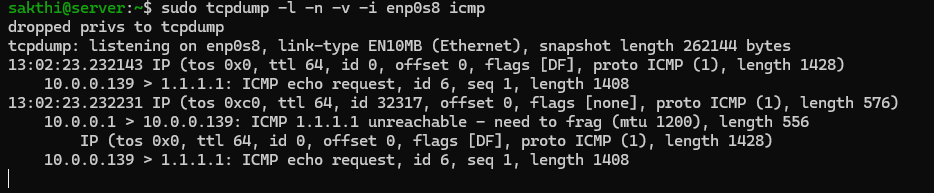

**One.** Six echo requests were attempted, and only the first one ever reached server:

```
IP (tos 0x0, ttl 64, id 0, offset 0, flags [DF], proto ICMP (1), length 1428)
    10.0.0.139 > 1.1.1.1: ICMP echo request, id 6, seq 1, length 1408
IP (tos 0xc0, ttl 64, id 32317, offset 0, flags [none], proto ICMP (1), length 576)
    10.0.0.1 > 10.0.0.139: ICMP 1.1.1.1 unreachable - need to frag (mtu 1200), length 556
        IP (tos 0x0, ttl 64, id 0, offset 0, flags [DF], proto ICMP (1), length 1428)
```

That's PMTUD working as designed: one round trip of feedback, and the sender adjusts.

- The ICMP error **quotes the original packet's header** (`flags [DF] ... length 1428`). That's how client knew which destination the error was about.
- `tos 0xc0` is the priority marking Linux gives its own network-control traffic.

**2. How long does client remember?**
`cache expires 593sec mtu 1200`. Client caches the path MTU per destination, for 600 s by default (`net.ipv4.route.mtu_expires`).

**3. Does real traffic notice?**

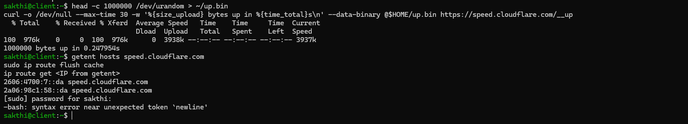

A 1 MB upload finished in **0.25 s**, and the whole upload needed **exactly one** "too big" message:

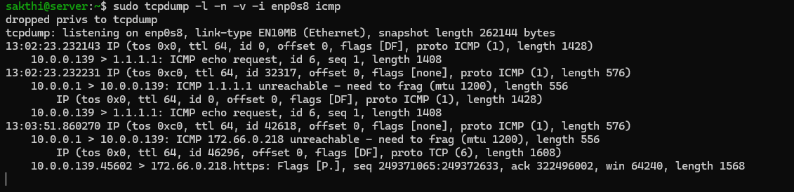

```
10.0.0.1 > 10.0.0.139: ICMP 172.66.0.218 unreachable - need to frag (mtu 1200), length 556
    IP (... flags [DF], proto TCP (6), length 1608)
    10.0.0.139.45602 > 172.66.0.218.https: Flags [P.], ... length 1568
```

The packet that triggered it was a **1568-byte** message sent before any upload data: the TLS ClientHello. That becomes important in Part 3.

**A detail I can't explain yet:** the quoted packet is 1608 bytes, bigger than client's own 1500 MTU. My guess is that offloading somewhere in the VM path merged two wire segments (1460 + 108 = 1568). Unverified.

---

## Part 3: The black hole

### The break

Same 1200 route, but now `server` throws away its own "fragmentation needed" messages:

```bash
sudo nft add table inet mtutest
sudo nft add chain inet mtutest out '{ type filter hook output priority 0; }'
sudo nft add rule inet mtutest out icmp type destination-unreachable icmp code frag-needed counter drop
```

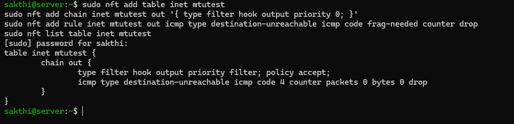

The separate `mtutest` table keeps this out of firewalld's rules. On client, `sudo ip route flush cache` first; otherwise it remembers 1200 from the last test and never falls into the hole.

### Symptoms (from `client`)

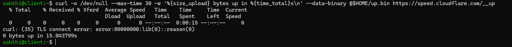

| Test | Result |
|---|---|
| 1 MB upload | ❌ 0 bytes, `curl: (35) TLS connect error` after **15.04 s** |

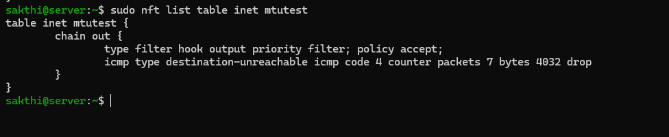

The nft counter: **7 packets, 4032 bytes** (7 × 576) of "too big" messages dropped.

I expected the handshake to work and the upload to stall partway through. It never got past the handshake.

### Investigation

**1. Why did the handshake fail?**
Client runs **OpenSSL 3.5.5**, which by default offers a post-quantum hybrid key share (X25519 combined with ML-KEM-768). That adds over a kilobyte to the ClientHello, which is the 1568-byte packet from Part 2. A classic TLS 1.3 ClientHello is a few hundred bytes.

To test it, I ran the upload twice, the second time with the post-quantum share turned off:

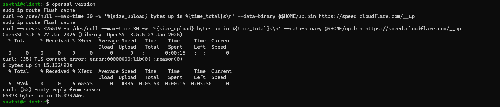

| Run | Uploaded | Time | Error |
|---|---|---|---|
| Default curves | 0 bytes | 15.13 s | `(35) TLS connect error` |
| `--curves X25519` | 65,373 bytes (6%) | 15.08 s | `(52) Empty reply from server` |

With the smaller ClientHello, the handshake got through, and the black hole moved to the upload itself, where I originally expected it.

**2. What was TCP doing for those 15 seconds?**

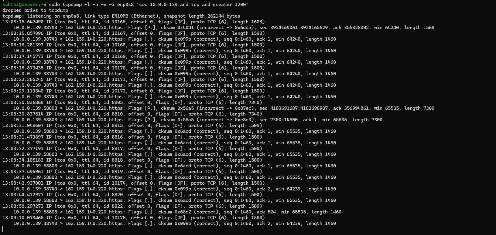

Sending the same first 1460 bytes over and over, waiting twice as long each time:

| Connection 38740 | Time | Gap |
|---|---|---|
| ClientHello | 13:08:15.642 | |
| Retransmit 1 | 15.857 | +0.21 s |
| Retransmit 2 | 16.281 | +0.42 s |
| Retransmit 3 | 17.145 | +0.86 s |
| Retransmit 4 | 18.873 | +1.73 s |
| Retransmit 5 | 22.265 | +3.39 s |
| Retransmit 6 | 29.113 | +6.85 s |

The original plus 6 retransmits is **7 packets**, matching the **7 drops** on the nft counter. Every attempt got a "too big" answer that never arrived.

**3. Did 65,373 bytes really upload?**
No. curl counts what it handed to the kernel's send buffer. The capture shows the first segment of the upload never got through, so almost nothing was actually delivered. **Progress bars measure what the sender wrote, not what the receiver got.**

**4. Why does the capture keep going after curl quit?**
Retransmits with `ack 2` show up at 13:08:42 and 13:09:10, after curl had already exited. The kernel keeps trying on behalf of the abandoned connection, and the ack moving to 2 means the far side had sent a FIN (closed its end). Both runs died at about 15 s, which looks like a timeout on the far end (Cloudflare or VirtualBox NAT). Unverified.

> Blocking ICMP doesn't produce an error. It produces a hang: the connection opens, then nothing moves.

### The fix (two ways)

**1. TCP MTU probing (on `client`)**

```bash
sudo sysctl -w net.ipv4.tcp_mtu_probing=1
```

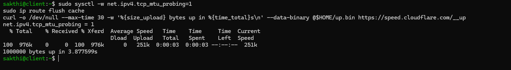
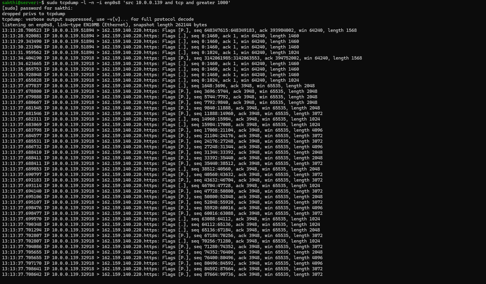

| Connection 32918 | Packet |
|---|---|
| 13:13:34.404 | `[P.] length 1568`: ClientHello, never arrives |
| 34.624, 35.056, 35.928 | `seq 0:1460`: three retransmits |
| 37.656 | **`seq 0:1024`**: black hole detected |
| 37.678 onward | handshake done, upload flowing |

After three timeouts with no progress, TCP assumed a black hole and fell back to `tcp_base_mss`, 1024 by default. That makes a 1064-byte packet on the wire, which fits. **1 MB in 3.88 s**: about 3.25 s spent detecting the problem, about 0.6 s uploading. Data packets afterward were 2048, 3072 and 4096 bytes, which is 2–4 real 1024-byte segments merged by offloading.

1024 is conservative. The path fits 1160, so probing wastes about 12% per packet. It's a safety net, not a precise fix.

(The capture also shows an earlier connection, 51894, with the same pattern. I only have one curl result for this step, so I can't say which run it belongs to.)

**2. MSS clamping (on `server`)**

Probing turned back off, then:

```bash
sudo nft add chain inet mtutest clamp '{ type filter hook forward priority mangle; }'
sudo nft add rule inet mtutest clamp 'tcp flags & syn == syn tcp option maxseg size set 1160'
```

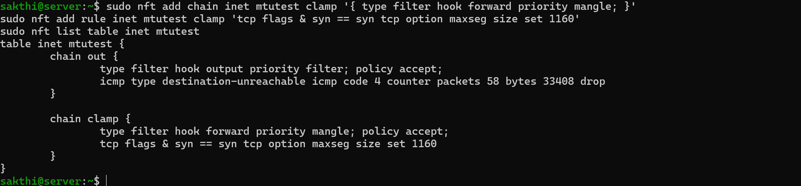

1160 = 1200 − 20 (IP header) − 20 (TCP header). The rule rewrites the MSS in every SYN and SYN-ACK that `server` forwards.

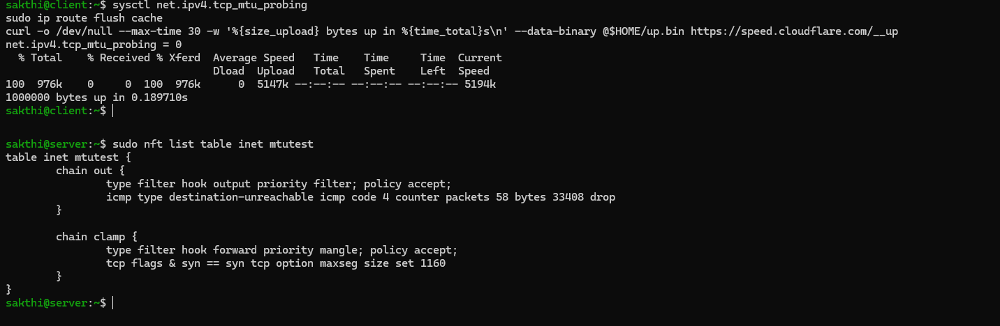

**1 MB in 0.19 s**, and the drop counter stayed at 58.

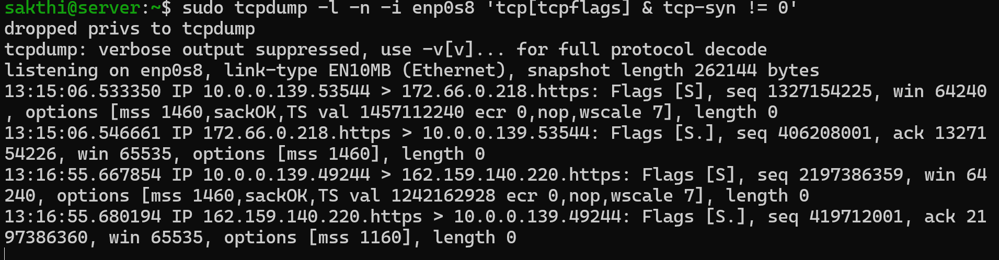

| Time | Connection | SYN (from client) | SYN-ACK (to client) |
|---|---|---|---|
| 13:15:06 | 53544, no clamp | `mss 1460` | `mss 1460` ❌ black hole |
| 13:16:55 | 49244, with clamp | `mss 1460` | **`mss 1160`** ✅ 0.19 s |

- Client's packet size comes from the MSS in the **SYN-ACK**, not its own SYN, so the SYN-ACK is the one that matters.
- The SYN still shows 1460 because tcpdump catches it arriving on `enp0s8`, before the forward hook rewrites it. The copy sent out to the internet should have been clamped too, but I didn't capture `enp0s3`, so that's expected, not verified.
- I used a fixed 1160 instead of the common `set rt mtu`. For the SYN-ACK, `rt mtu` would look up the route toward *client* (1500, no change), since only the internet-side route was limited.

### After the fix

| Setup | Upload result | Time | Depends on ICMP? |
|---|---|---|---|
| PMTUD working | ✅ 1,000,000 bytes | 0.25 s | yes |
| Black hole | ❌ 0 bytes | 15.04 s | broken |
| Black hole + MTU probing | ✅ 1,000,000 bytes | 3.88 s | no |
| Black hole + MSS clamp | ✅ 1,000,000 bytes | **0.19 s** | no |

(One run each, so 0.19 vs 0.25 is noise.) Clamping wins because it fixes the problem **before the first data packet goes out**, while probing has to fail three times first. It's also invisible to both ends and needs no ICMP, which is why it's the standard fix on VPN gateways and PPPoE links.

### Cleanup

```bash
# server
sudo nft delete table inet mtutest
sudo ip route del default via 10.0.2.2 dev enp0s3 metric 102 mtu lock 1200
# client
sudo sysctl -w net.ipv4.tcp_mtu_probing=0
sudo ip route flush cache
```

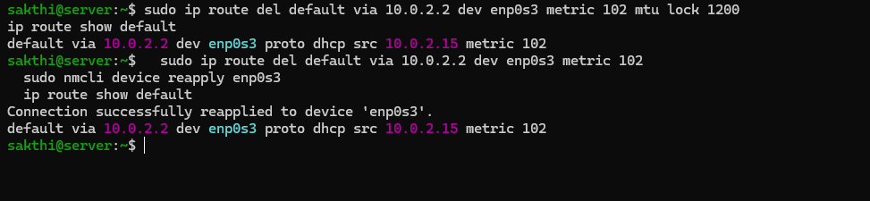

One clean default route, only `table inet firewalld` left in nftables, and both interfaces back at 1500. (Undoing the route took two tries; see "Where it cracked.")

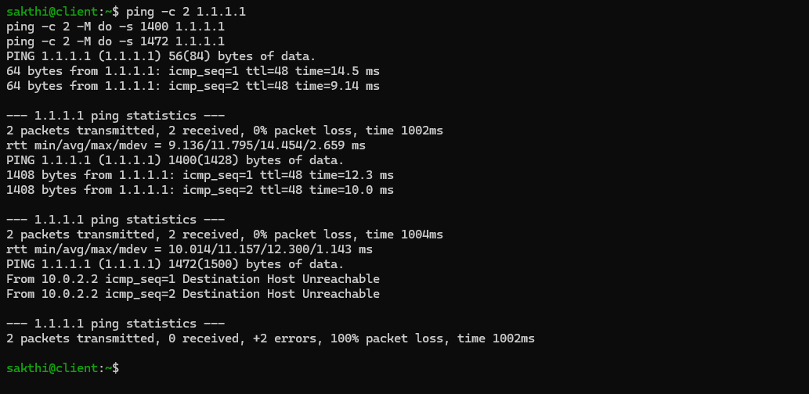
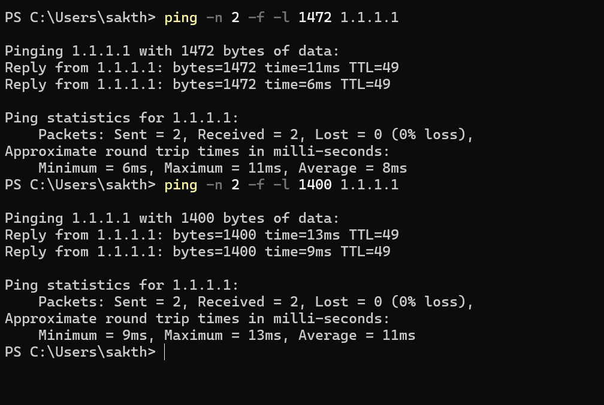

| Ping to 1.1.1.1 | From `client` (through server) | From Windows |
|---|---|---|
| small | ✅ TTL 48 | not run |
| 1428 bytes, DF | ✅ | ✅ |
| 1500 bytes, DF | ❌ `Host Unreachable` from **10.0.2.2** | ✅ TTL 49 |

The 1428-byte ping proves the 1200 limit is gone. The 1500 failure is a separate VirtualBox issue (below). TTL 48 vs 49 is `server` showing up as one extra routing hop.

---

## Where it cracked

### The network card froze
Changing `enp0s3`'s MTU froze every SSH session. Ctrl+C did nothing, and server's console filled with this about every 2 seconds:

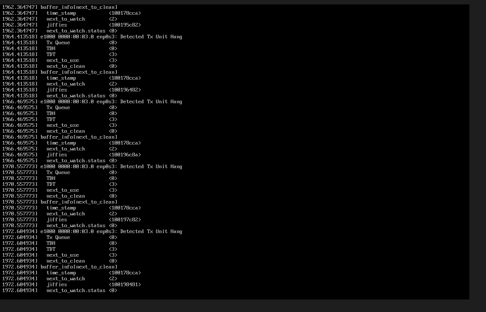

```
e1000 0000:00:03.0 enp0s3: Detected Tx Unit Hang
  TDH <0>
  TDT <3>
```

TDH and TDT are the head and tail pointers of the card's transmit ring. The driver had queued 3 packets (TDT = 3), but the virtual card never processed even the first one (TDH stuck at 0). Nothing could leave `enp0s3`, and all my SSH sessions come in through `enp0s3`.

**Cause (likely):** changing an e1000's MTU makes the driver reset the card, and VirtualBox's emulated e1000 didn't come back from that reset. The same change on `enp0s8` worked four times without trouble. One difference is that `enp0s3` was carrying live SSH traffic at the moment it reset. The exact trigger is unverified.

**Fix:** kill the frozen session with SSH's escape sequence (Enter, `~`, `.`), then on server's VirtualBox console:

```bash
sudo dmesg -n 1                          # stop kernel messages flooding the console
sudo ip link set enp0s3 down
sudo ip link set dev enp0s3 mtu 1500
sudo ip link set enp0s3 up
```

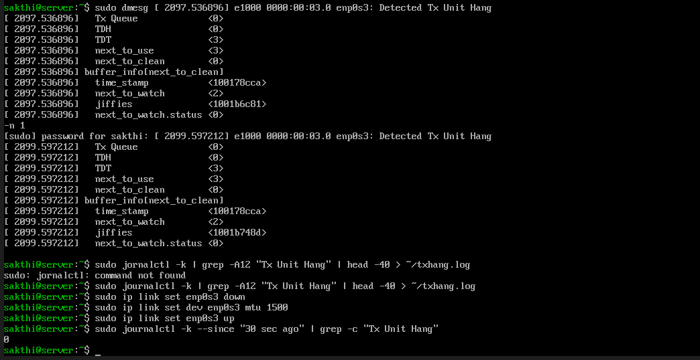

Zero new hang messages after that. Taking a link down deletes its routes, so I checked that the default route came back (NetworkManager restored it) and that server could still reach the internet:

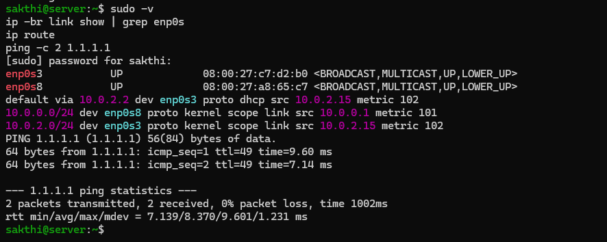

**Lesson:** don't change the MTU on the interface you're managing the machine through. Change the route instead, or have console access ready. In production you'd almost never take an uplink down just to change its MTU.

### Typing into a flooded console
I typed `jornalctl` twice while kernel messages scrolled over everything. `sudo dmesg -n 1` stops them printing to the console (they still go to the journal). Quiet the console first, then work.

### A literal placeholder
```
-bash: syntax error near unexpected token `newline'
```
I pasted `ip route get <IP from getent>` as-is, and bash read `<` as a redirect. On top of that, `getent hosts` returned only IPv6 addresses, while the upload actually went over IPv4 to 172.66.0.218 (visible in the tcpdump). `getent ahostsv4` gives the IPv4 address.

### `fwd` is a reserved word in nft
```
Error: syntax error, unexpected fwd, expecting string or last
```
`fwd` is the name of an nftables statement, so it can't be a chain name. The `unexpected '}'` error was just a side effect. I renamed the chain to `clamp`.

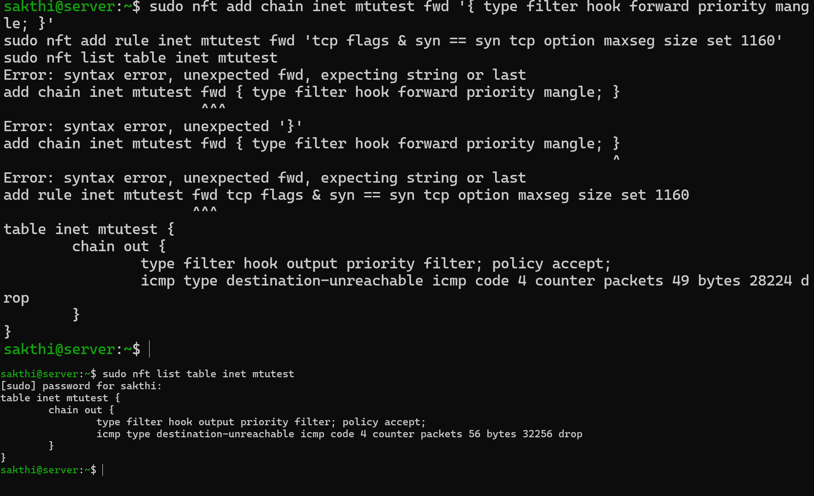

The failed attempt turned into a useful "before" run: the counter went from 49 to 56 on an unclamped upload.

### NetworkManager put the route back
Undoing the route MTU with `ip route change` returned `RTNETLINK answers: File exists`, and server ended up with **two** default routes, one still `mtu lock 1200`:

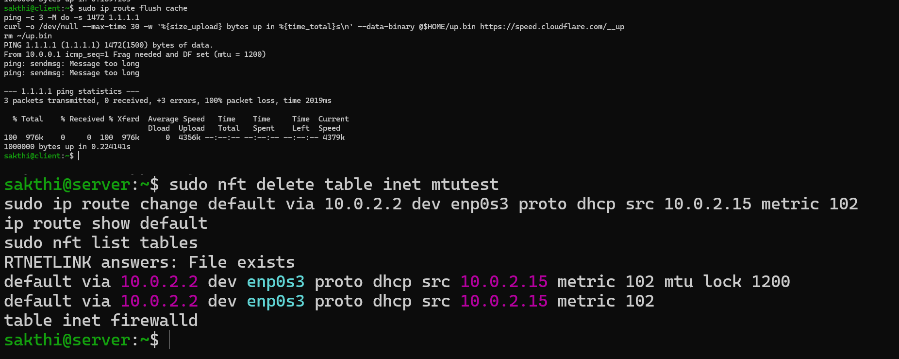

Client kept getting "fragmentation needed" at 1200, even though the upload worked again (the drop rule was gone, so PMTUD was back).

**Cause (likely):** NetworkManager noticed its route had been changed and added a clean copy next to it. Unverified.

**Fix:** `ip route del` with `mtu lock 1200` in the command removed exactly the right one. `nmcli device reapply enp0s3` brings back a clean route if needed.

**Lesson:** NetworkManager owns the routes it creates. Hand edits work for a quick test, but NetworkManager will notice.

### 1500-byte pings die at VirtualBox NAT
After cleanup, a 1500-byte DF ping from client to 1.1.1.1 got `Destination Host Unreachable` from **10.0.2.2**, while 1428 bytes worked. Windows pings 1.1.1.1 at 1500 with DF just fine, and the 1 MB upload was unaffected. So it's VirtualBox NAT's ping relay, not the lab. My baseline only tested 1500 bytes to `10.0.0.1`, so this was probably true before the challenge started.

**Lesson:** a baseline should cover every path you'll test later, not just the first hop.

### The wrong baseline URL
My first "download baseline" went to `instagram.com` with no `https://` and reported **0 bytes**. That was a redirect, not a measurement. I redid it with the 1 MB endpoint before breaking anything.

### Client vanished before I started
The first SSH jump to client failed with `No route to host`, and server's ARP entry for `10.0.0.139` was `FAILED`, even though dnsmasq still had a valid lease for it. Restarting client fixed it. I didn't find the root cause.

---

## Still unfinished

- [x] ~~Challenge 4: shrink the MTU, watch fragmentation and PMTUD, make a black hole, fix it two ways~~
- [ ] Run `ping -c 2 -M do -s 1472 1.1.1.1` **on server** to confirm the 1500-byte ping limit is VirtualBox's
- [ ] Check offloading (`ethtool -k enp0s8 | grep -E 'generic-receive|tcp-segmentation'`) to explain the 1608- and 7340-byte packets
- [ ] Capture `enp0s3` with the clamp on, to confirm the SYN going out to the internet is clamped too
- [ ] DNS quirk: server sent `udp port 35329 unreachable` to **both** 1.1.1.1 and 128.8.76.2 (UMD). This is the same "stray line" from Challenge 1, and now the second DNS server has a name. Likely dnsmasq is also using UMD's DNS from `/etc/resolv.conf`, because `lab.conf` has no `no-resolv`. Might also explain the `server.umd.edu` name.
- [ ] Regenerate `client`'s MAC address
- [ ] Read up on `rp_filter`
